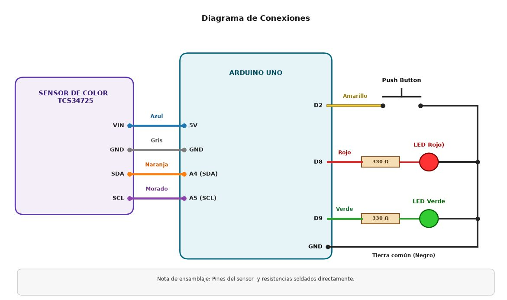

# Neurona-Artificial
# Clasificador de Frutas en Tiempo Real con Perceptrón Simple (Arduino UNO + TCS34725)

Sistema embebido de colorimetría basado en **una sola neurona artificial (perceptrón de un solo nivel)** capaz de clasificar en tiempo real entre **limón (`0`)** y **jitomate (`1`)** a partir de las lecturas espectrales normalizadas ($R, G, B$) obtenidas mediante un sensor **TCS34725** y ejecutado en un microcontrolador **Arduino UNO**.

---

## Arquitectura del Modelo

El modelo se entrenó en Python utilizando **TensorFlow / Keras** con una topología estricta de **$3 \rightarrow 1$** (sin capas ocultas) y función de activación logística (**Sigmoide**):

$$z = (R \cdot w_1 + G \cdot w_2 + B \cdot w_3) + b$$

$$y = \sigma(z) = \frac{1}{1 + e^{-z}}$$

* **Entradas ($R, G, B$):** Proporciones cromáticas normalizadas en el rango $[0, 1]$ dividiendo cada canal crudo entre el canal *Clear* ($C$).
* **Criterio de decisión:**
  * $y \ge 0.5 \rightarrow$ **Jitomate (`1`)** — Enciende LED Rojo (`D8`).
  * $y < 0.5 \rightarrow$ **Limón (`0`)** — Enciende LED Verde (`D9`).

### Parámetros Entrenados (400 épocas, `Adam`, `lr = 0.05`)

| Parámetro | Valor | Interpretación Física |
| :--- | :---: | :--- |
| **$w_1$ (Rojo)** | `26.821363` | Impulsa la salida hacia `1` (Jitomate) ante tonos rojizos. |
| **$w_2$ (Verde)** | `-20.791611` | Penaliza la suma hacia `0` (Limón) cuando predomina el verde. |
| **$w_3$ (Azul)** | `14.432850` | Complementa la separación del plano en el espacio cromático. |
| **$b$ (Sesgo)** | `-7.745699` | Desplaza el hiperplano separador para fijar el umbral óptimo. |

---

## Resultados del Entrenamiento

* **Dataset:** `196` muestras capturadas en entorno controlado a una distancia fija de **$1.5\text{ cm}$** (`77` limones y `119` jitomates).
* **Exactitud global (*Binary Accuracy*):** **`80.61%`** (`loss: 0.4228`).

### Matriz de Confusión

| | Predicción: Limón (`0`) | Predicción: Jitomate (`1`) |
| :--- | :---: | :---: |
| **Real: Limón (`0`)** | **50** | 27 |
| **Real: Jitomate (`1`)** | 11 | **108** |

---

## Hardware y Diagrama de Conexiones



### Componentes
* **Microcontrolador:** Arduino UNO (ATmega328P)
* **Sensor de color:** Adafruit TCS34725 ($\text{I}^2\text{C}$, filtro IR y LED blanco integrado)
* **Actuadores e interfaz:** 1 LED Rojo, 1 LED Verde, 2 resistencias de $330\,\Omega$, 1 *Push Button* y gabinete con cámara oscura a $1.5\text{ cm}$.

### Pinout y Código de Colores

| Componente | Pin Módulo | Pin Arduino UNO | Color de Cable | Notas de Ensamblaje |
| :--- | :---: | :---: | :---: | :--- |
| **TCS34725** | `VIN` | `5V` | Azul | Alimentación principal |
| **TCS34725** | `GND` | `GND` | Gris | Tierra del sensor |
| **TCS34725** | `SDA` | `A4` | Naranja | Datos $\text{I}^2\text{C}$ (pines soldados) |
| **TCS34725** | `SCL` | `A5` | Morado | Reloj $\text{I}^2\text{C}$ (pines soldados) |
| **Push Button** | Terminal 1 | `D2` | Amarillo | Configurado como `INPUT_PULLUP` |
| **LED Rojo** | Ánodo (+) | `D8` | Rojo | Con resistencia de $330\,\Omega$ soldada |
| **LED Verde** | Ánodo (+) | `D9` | Verde | Con resistencia de $330\,\Omega$ soldada |
| **Tierra Común** | Cátodos / Botón | `GND` | Negro | Retorno común |

---

## Estructura del Repositorio

```text
Neurona Artificial/
├── Neurona/
│   ├── entrenamiento.py              # Entrenamiento del perceptrón en TensorFlow/Keras y matriz de confusión
│   └── entrenar.txt                  # Dataset normalizado de 196 muestras (R G B Etiqueta)
├── Entrenamiento_Frutas.ino          # Sketch de Arduino para recolección inicial de muestras RGB
├── Neurona.ino                       # Sketch final de inferencia en C++ con debouncing y control de LEDs
├── Diagrama_de_Conexiones.jpeg       # Esquema de cableado y código de colores del prototipo
├── Trabajo-Final-Neurona.pdf         # Reporte técnico completo del proyecto
└── README.md
